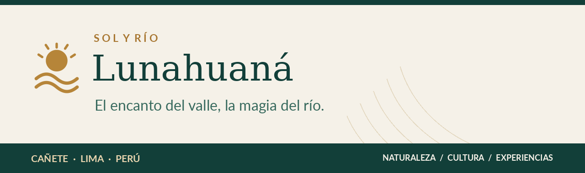
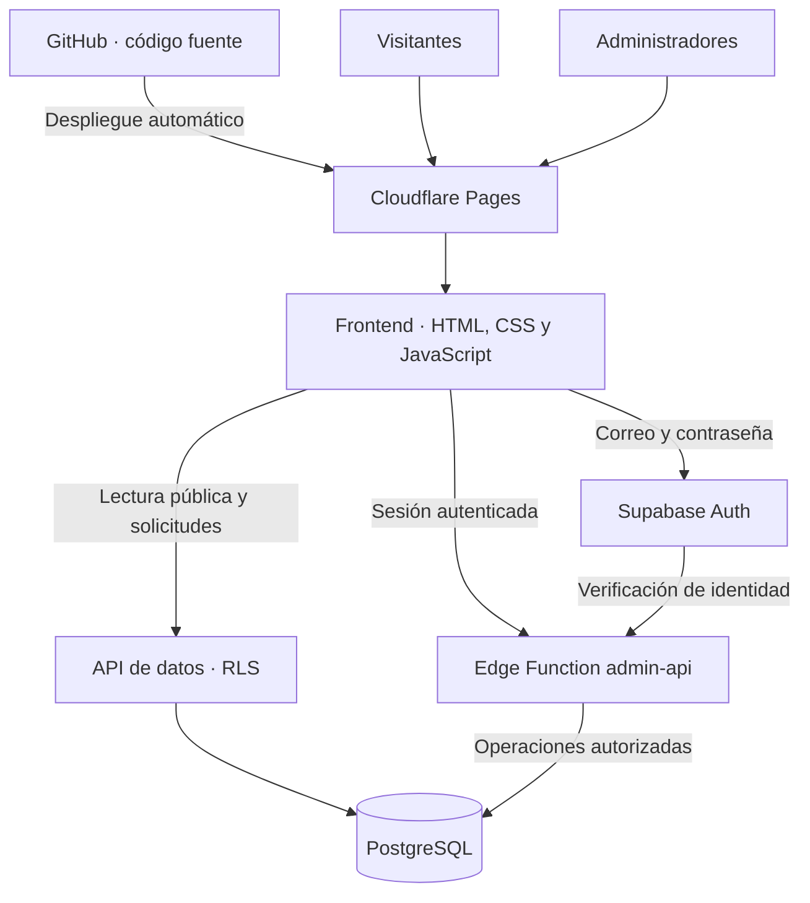

<div align="center">
  <a href="https://sol-y-rio-lunahuana.pages.dev/">
    
  </a>

  <p><strong>Descubre el valle. Vive sus tradiciones. Planea tu próxima aventura.</strong></p>

  <a href="https://sol-y-rio-lunahuana.pages.dev/"></a>
  <a href="https://sol-y-rio-lunahuana.pages.dev/#paquetes"></a>

  <br/>

  
  
  
  
  
  
  

  <p>Proyecto académico · Turismo digital · Cañete, Lima, Perú</p>
</div>

---

## 🌿 Sobre el proyecto

**Sol y Río Lunahuaná** es una plataforma web que promueve la riqueza natural, cultural y turística de Lunahuaná, en la provincia de Cañete. Reúne información sobre sus paisajes, actividades de aventura, productos tradicionales y festividades, y facilita el envío de solicitudes de reserva y consultas.

El proyecto combina una experiencia visual inspirada en el valle — tonos verdes, dorados y cálidos — con un sistema de gestión de contenidos conectado a una base de datos en la nube.

**Web publicada:** [sol-y-rio-lunahuana.pages.dev](https://sol-y-rio-lunahuana.pages.dev/)

> Proyecto de demostración académica. Los precios y servicios de los paquetes son referenciales; una solicitud no constituye una reserva comercial confirmada.

## 🧭 Explora la plataforma

| Sección | Experiencia |
| :--- | :--- |
| 🏞️ [Atractivos turísticos](https://sol-y-rio-lunahuana.pages.dev/#atractivos) | Conoce los paisajes y lugares de interés del valle. |
| 🚣 [Actividades](https://sol-y-rio-lunahuana.pages.dev/#actividades) | Descubre experiencias de aventura y recreación. |
| 🧳 [Paquetes turísticos](https://sol-y-rio-lunahuana.pages.dev/#paquetes) | Consulta duración, precio y servicios incluidos. |
| 🍇 [Cultura y tradiciones](https://sol-y-rio-lunahuana.pages.dev/#cultura) | Explora la producción local, las festividades y las raíces de Lunahuaná. |
| 📅 [Reservas](https://sol-y-rio-lunahuana.pages.dev/#reservar) | Envía una solicitud de reserva sin crear una cuenta. |
| ✉️ Contacto | Envía consultas a través del formulario de la plataforma. |

## 🛡️ Panel administrativo

La plataforma dispone de una interfaz de gestión destinada a administradores autorizados. Permite consultar estadísticas, gestionar atractivos, actividades, paquetes y festividades, así como revisar las reservas y mensajes recibidos.

| Visitantes | Administradores autorizados |
| :--- | :--- |
| Navegación libre, sin registro | Inicio de sesión con correo y contraseña |
| Consulta de contenido publicado | Creación, edición y eliminación de contenido |
| Envío de solicitudes y consultas | Gestión de reservas y mensajes |
| Sin acceso a información privada | Operaciones autorizadas por el servidor |

El acceso administrativo se realiza mediante Supabase Auth y una Edge Function (`admin-api`). La autorización se comprueba en el servidor contra las cuentas aprobadas; conocer el enlace del panel no concede privilegios. Las políticas RLS protegen las tablas frente a operaciones no autorizadas. Las claves privadas se mantienen fuera del frontend y del repositorio web.

## ⚙️ Arquitectura



| Tecnología | Responsabilidad |
| :--- | :--- |
| HTML, CSS y JavaScript | Estructura, diseño adaptable e interacción con las APIs. |
| Supabase Auth | Autenticación de administradores. |
| Supabase Edge Functions / Deno | Validación y operaciones administrativas del lado del servidor. |
| PostgreSQL | Persistencia de información turística, reservas y consultas. |
| Git y GitHub | Control de versiones y repositorio del frontend. |
| Cloudflare Pages | Alojamiento HTTPS y despliegue automático. |

## 🗄️ Base de datos

El backend está organizado en ocho tablas principales:

| Tabla | Información |
| :--- | :--- |
| `atractivos_turisticos` | Lugares y puntos de interés. |
| `actividades` | Experiencias, precios y duración. |
| `paquetes_turisticos` | Planes, precios y servicios incluidos. |
| `agropecuaria` | Productos y producción local. |
| `festividades` | Celebraciones y tradiciones. |
| `reservas` | Solicitudes y estado de atención. |
| `mensajes_contacto` | Consultas de los visitantes. |
| `configuracion` | Parámetros del sitio. |

## 📁 Estructura del repositorio

```text
sol-y-rio-lunahuana/
├── index.html             # Interfaz pública y administrativa
├── styles.css             # Identidad visual y diseño responsive
├── script.js              # Lógica, autenticación e integración con Supabase
├── creditos.html          # Créditos fotográficos
├── build.sh               # Construcción del sitio para Cloudflare
├── docs/
│   └── banner-sol-y-rio.png
├── .gitignore
└── README.md
```

La configuración SQL y la Edge Function se mantienen en la copia de desarrollo y se despliegan por separado en Supabase; este repositorio corresponde a los archivos de la web.

## 🚀 Desarrollo y publicación

Desde una copia local del repositorio, inicia un servidor HTTP:

```bash
python3 -m http.server 5500
```

Abre `http://localhost:5500`. La aplicación utiliza el proyecto Supabase configurado en el frontend. Evita realizar pruebas con datos personales reales.

Configuración de Cloudflare Pages:

| Campo | Valor |
| :--- | :--- |
| Rama de producción | `main` |
| Framework | `None` |
| Comando de construcción | `sh build.sh` |
| Directorio de salida | `public` |

Las actualizaciones de la rama `main` activan el despliegue automático de la web. Los cambios del backend se despliegan por separado.

## 📷 Créditos y contexto

Las imágenes del sitio muestran el entorno y las tradiciones de Lunahuaná. Sus fuentes y autores están indicados en la [página de créditos fotográficos](https://sol-y-rio-lunahuana.pages.dev/creditos.html). Algunas imágenes son representativas del entorno y no documentan necesariamente un servicio o evento específico.

Proyecto académico desarrollado en equipo, con el propósito de aplicar tecnologías web a la promoción turística de Cañete.

---

<div align="center">
  <strong>Hay lugares que se visitan. Otros se viven.</strong>
  <br/>
  <sub>Sol y Río Lunahuaná · Naturaleza, tradición y experiencias.</sub>
  <br/><br/>
  <a href="https://sol-y-rio-lunahuana.pages.dev/">Volver a la página web ↗</a>
</div>
